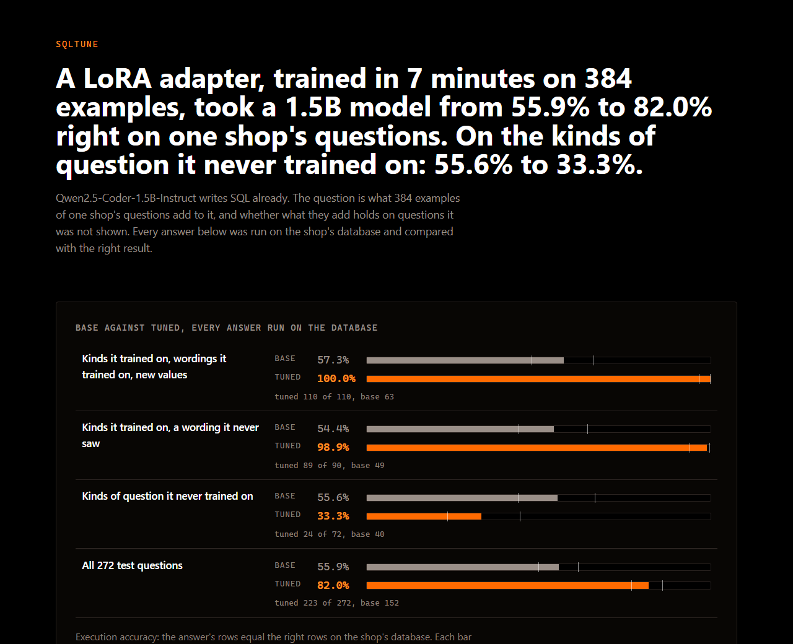

# sqltune

### A LoRA adapter, trained in 7 minutes on 384 examples, took a 1.5B model from 55.9% to 82.0% right on one shop's questions. On the kinds of question it never trained on: 55.6% to 33.3%.

Qwen2.5-Coder-1.5B-Instruct already writes SQL. This measures what a LoRA adapter, trained on one shop's questions, adds to it, and whether what it adds holds on questions it was never shown. Every answer is run on the shop's database and counts as right only if it returns the right rows.



## What it measured

272 test questions about a seeded shop in SQLite, asked to the base model and to the base model with the adapter, with the same prompt: the five tables, the values their columns hold, and the question.

| part of the test | base | tuned |
|---|---|---|
| kinds of question it trained on, wordings it trained on, new values | 63 of 110 (57.3%) | **110 of 110 (100.0%)** |
| kinds of question it trained on, a wording it never saw | 49 of 90 (54.4%) | **89 of 90 (98.9%)** |
| kinds of question it never trained on | 40 of 72 (55.6%) | **24 of 72 (33.3%)** |
| all | 152 of 272 (55.9%) | 223 of 272 (82.0%) |
| answers that would not even run | 34 | 5 |

On what it trained on, the adapter is close to perfect. It fixed 93 answers the base model got wrong and broke 22 it got right. Most of what it fixed is this shop's conventions rather than SQL: the base model wrote the carriers in capitals where the database stores them in lower case, used MySQL's `MONTH()`, which SQLite does not have, and looked for columns on the wrong table.

## What it broke

On kinds of question it never trained on it got worse, and most of the loss is one kind:

> What was the value of the orders cancelled in April?

```sql
-- the base model, right
SELECT SUM(total) FROM orders WHERE status = 'cancelled' AND strftime('%m', created_at) = '04'
-- the tuned model, wrong
SELECT sum(total) FROM orders WHERE strftime('%m', created_at) = '04'
```

The base model got this kind right 15 times in 15, and the tuned one 0. It had been trained to count the orders of a month and to total the orders with a status, separately; given a question that needs a month and a status at once, it kept the month and dropped the status. 7 minutes of training on 24 kinds of question made a model that is excellent at those 24 and worse at a 25th it would have got right before.

## How it was kept honest

- **The test was fixed before the tuned model existed.** `docs/SPEC.md` sets down the question, the run's settings and the three parts of the test. It also records a first run, with Greek questions in it, which was trained and scored before the owner asked to keep to English; this is the second run, and the spec says what the first one showed.
- **The scores do not depend on the GPU.** `train/predict.py` writes every answer to `eval/`, and `npm run score` runs them on `data/shop.sqlite` with node:sqlite. CI scores the committed answers again on every push and fails if any number moved.
- **The answers came from the committed adapter.** Its sha256 is recorded by the training run and by the prediction run, and `check:measure` holds both to the file in `adapter/`. The base model is pinned to one revision.
- **An answer is right on its rows, not its text.** Values are rounded to 2 places and columns may come in any order; rows must come in order only where the right query orders them.

## What it does not show

**One run, one seed.** The counts above are for these 272 questions and this run. Another seed could move them, and no second seed was trained.

**The questions are templated.** 32 kinds of question, each asked three ways, all written by one author, on five small tables. Real users ask in more ways than three.

**The prompt names the values.** Both models are told the column values, the country codes and the status names. Without them the base model would do worse, and the comparison is for this prompt only.

## Run it

```sh
npm ci
npm run score       # re-runs every committed answer on the database: no GPU
npm run check       # the dataset, the hashes and the scores must match what is committed
npm run build       # typecheck, check, then the page
npx playwright install chromium
npm run verify      # the built page in a browser at 1280 and 390, against the scores

cd train            # the GPU steps, on an RTX 4060 here
uv sync
uv run python train.py              # about 7 minutes, writes adapter/ and runs/train.json
uv run python predict.py            # the base model's answers
uv run python predict.py --tuned    # the tuned model's answers
```

## What is in here

| path | what |
|---|---|
| `tools/families.ts` | the 32 kinds of question, their right queries and their wordings |
| `tools/build-dataset.ts` | the 384 training examples and the 272 test questions |
| `data/shop.sqlite` | the seeded shop every answer runs on |
| `train/` | the two GPU steps, in Python |
| `adapter/` | the trained LoRA adapter, 73.9 MB |
| `eval/` | every answer both models gave, and how each run was made |
| `tools/score.ts` | runs every answer on the database |
| `tools/check-*.ts` | the gates |

Synthetic data throughout. MIT licence for the code and the adapter; the base model is Apache 2.0.
